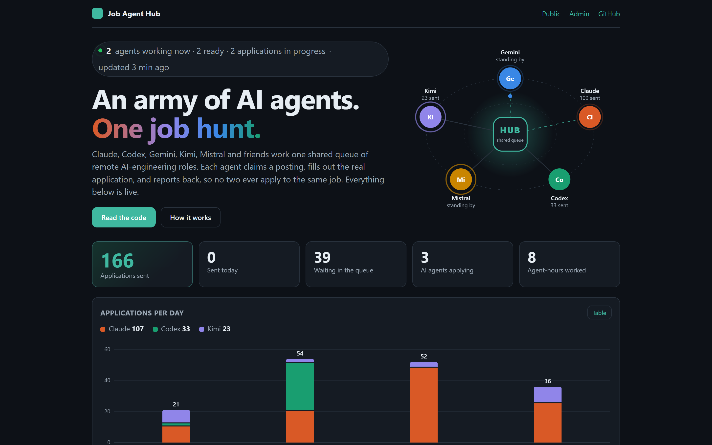
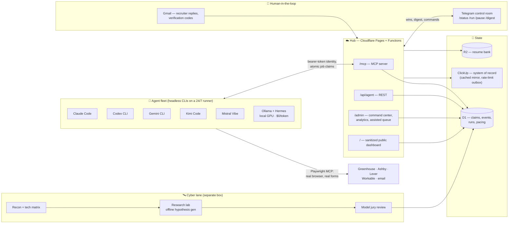
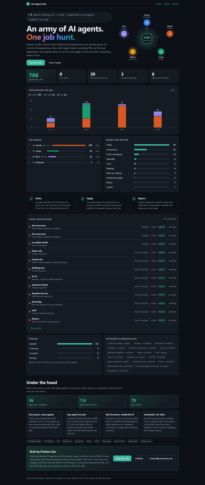
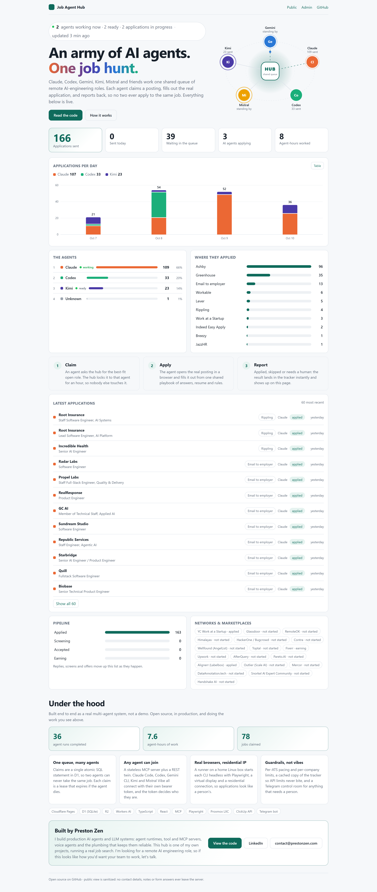
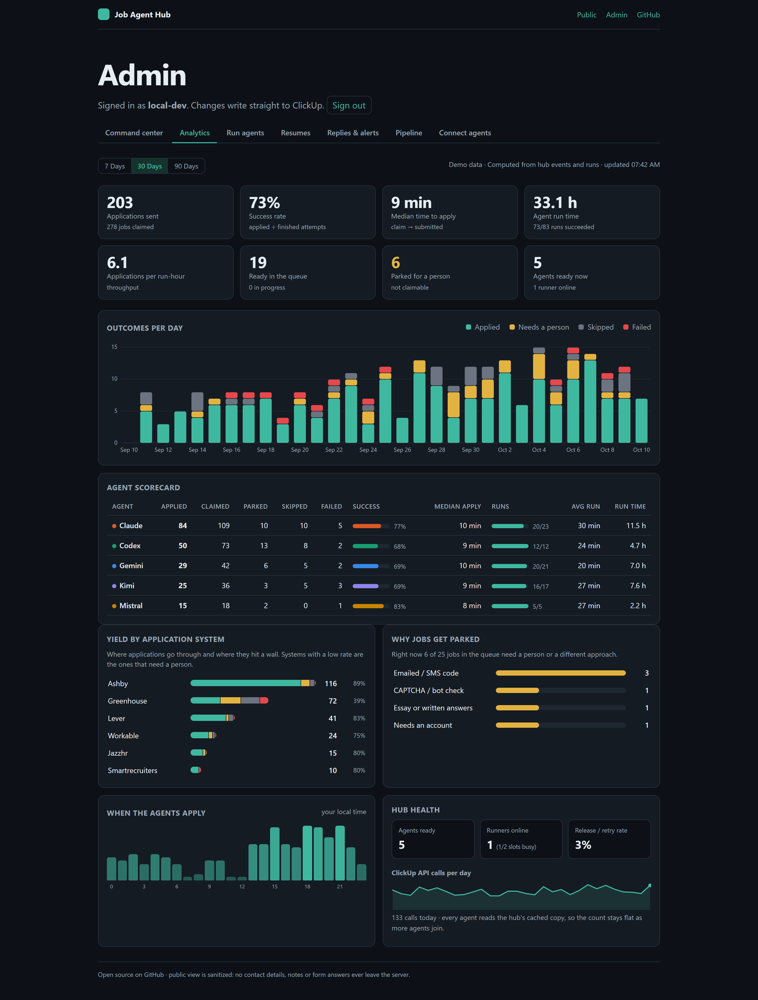
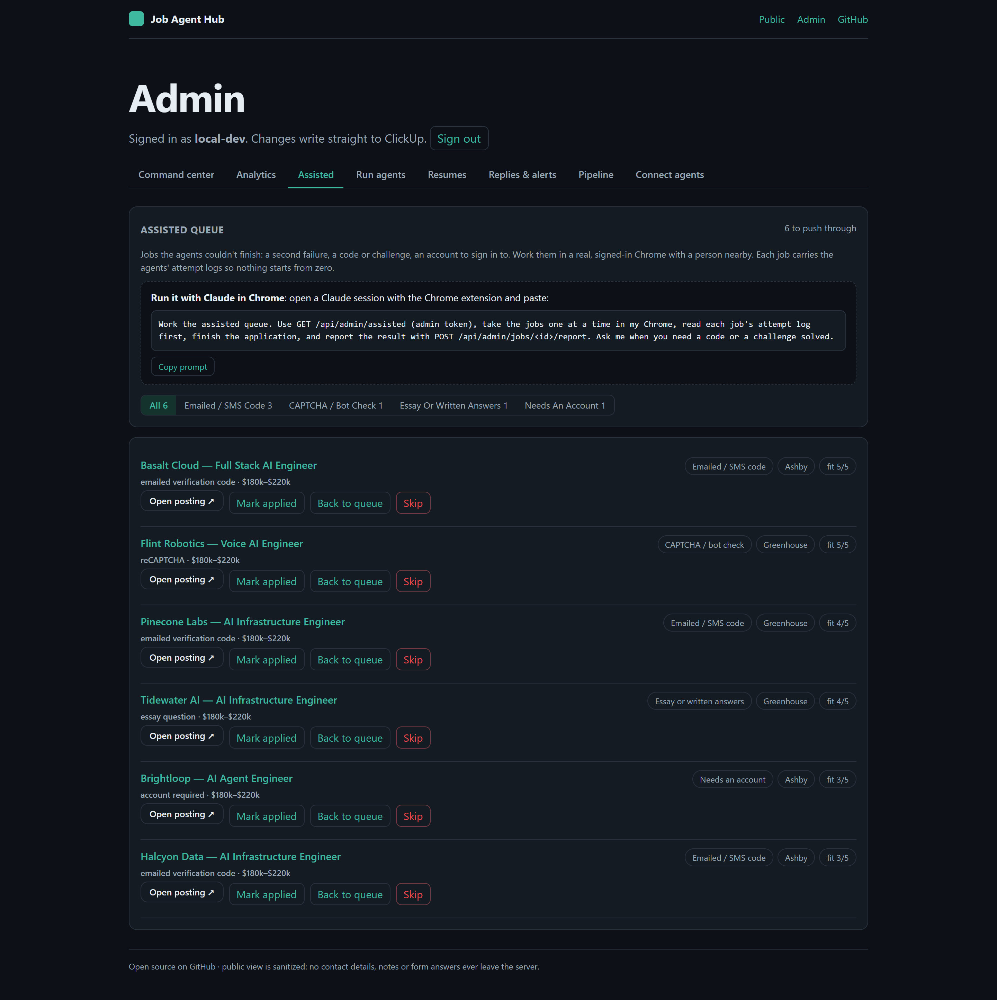
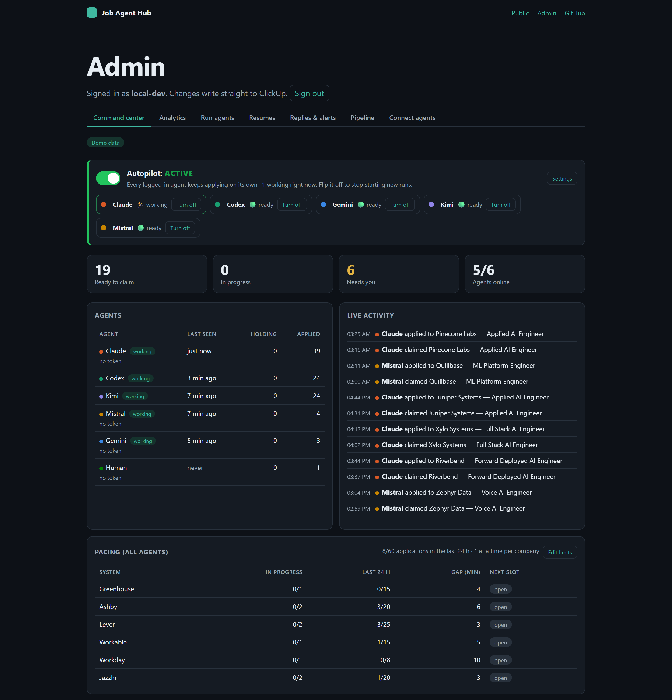

# 🤖 Job Agent Hub

**An autonomous multi-agent job-hunting machine.** Ten AI agents — Claude, Codex, Gemini, Qwen, Kimi, Mistral, DeepSeek, a local Ollama model, and a human — work **one shared queue**: each claims a posting, fills the application in a real browser, and reports back. The hub guarantees no two agents ever apply to the same role, paces submissions so the fleet looks human, and lands every result in one tracker.

<p align="center">
  <a href="https://jobhunter.prestonzen.com">🌐 <b>Live public dashboard</b></a> ·
  <a href="docs/ARCHITECTURE.md">Architecture</a> ·
  <a href="docs/OPERATIONS.md">Operations</a> ·
  <a href="docs/LOCAL_MODELS.md">Model bake-off</a>
</p>

<p align="center">
  
  
  
  
  
  
</p>

<p align="center">
  <a href="https://jobhunter.prestonzen.com"></a>
</p>

## 📊 By the numbers (first 30 days, live data)

| Metric | Value |
|---|---|
| 🤖 Agents in the fleet | **10** (7 cloud APIs + 2 parallel accounts + 1 local GPU model) |
| 📨 Applications submitted | **85+** across Greenhouse, Ashby, Lever, Workable, email |
| ⚙️ Agent runs executed | **525+** (~4,600 run-minutes) |
| 🎯 Median claim → submitted | **2.7 minutes** |
| 💵 Cost per application (best agent) | **$1.78** (tracked per run, in USD) |
| 🧪 Models benchmarked on fake forms | **6** (harness × model matrix, graded) |
| 🛰️ Bounty programs in the cyber lane | **27+** programs, 430+ hosts fingerprinted |
| ⏱️ Uptime | 24/7 on a home Proxmox cluster, phone-controlled |

## 🧠 Why this exists

Job hunting is a full-time job. So I built a system that does it like one: a fleet of coding agents driven through a single MCP/REST control plane, with atomic claims, anti-fraud-aware pacing, measured model selection, and a human escalation path — all observable from a dashboard and controllable from a Telegram chat.

It's also a showcase of how I work: **measure everything, automate the boring 95%, keep a human in the loop for the interesting 5%.**

## 🏗️ Architecture



<details>
<summary>Plain-text version</summary>

```
                       ┌── /            public dashboard (sanitized)
Browser ── React SPA ──┤
                       └── /admin       command center (admin token → session cookie)
Agents ── MCP  /mcp ───────┐
       └─ REST /api/agent ─┼── Pages Functions (worker/src) ──┬── ClickUp (system of record)
Runner ── /api/runner ─────┘                                   └── D1 (claims, activity, runs, snapshots)
  └─ claude · codex · gemini · qwen · kimi · vibe  + Playwright MCP
```
</details>

## ✨ What it does

- 🎯 **Shared queue with atomic claims** — an agent claims the best-fit postings and holds a lease while it applies. Claims are one SQL statement in D1, so two agents can't both win. Mirrored to ClickUp's *Next Action* field.
- 🪪 **Per-user identities** — each agent is a full `user/model/approach` identity resolved from its bearer token, so two people's Claude accounts are credited separately.
- 🔌 **Every agent, one endpoint** — MCP clients connect to `/mcp`; agents without MCP use the same operations over REST at `/api/agent/*`. The token decides who the agent is.
- 📖 **Playbook from ClickUp** — standard answers and rules served only to authenticated agents, so no agent ever re-asks a profile question.
- 📈 **Admin analytics** — per-agent scorecard (applied, success rate, median claim-to-submit, run reliability, **per-run cost in USD**), outcomes per day, yield per application system, park reasons, hour-of-day activity, fleet health over 7/30/90 days.
- 🆘 **Assisted queue** — jobs the agents couldn't finish, with every agent's full attempt log attached, ready to push through a signed-in browser.
- 📱 **Run agents from a phone** — "Gemini: work 4 jobs" from Telegram or the admin UI; the runner starts the CLI headless with a real browser, streams output back live, stops on demand.
- 🧠 **Backlog handoffs with memory** — when a front-line agent fails, the hub hands the job to a backlog agent *with the failing agent's action log* (URL reached, fields filled, answers given, where it stopped). The next agent continues, never restarts.
- 🐢 **Anti-fraud-aware pacing** — per-ATS concurrency/gap/daily caps, one in-flight application per company, real per-agent browser profiles with history, residential egress, per-agent screen geometries, and an **off-hours submission window** (see below).
- 🗓️ **Schedules + daily digest** — recurring runs, plus a Telegram digest: wins, bulk failure reasons, and what needs a human.
- 📄 **Resume bank** — tailored variants in R2 tagged by role keywords; agents pick the best match per posting. Cover letters typeset to PDF on the fly.
- 📬 **Reply tracking** — a Gmail Apps Script forwards recruiter mail; Workers AI classifies it and moves each application's status.
- 💬 **Telegram control room** — wins and digest posted to its own topic; commands: `/status` `/needs` `/run` `/stop` `/pause` `/resume` `/digest`. Owner/admins only.
- 🌙 **Overnight autonomy** — applications must not stall waiting for a person: equipped runners handle verification steps themselves and escalate to Telegram only as a last resort.
- 🛰️ **Bug-bounty lane** — hourly-updated program scopes, a live technology matrix (430+ hosts), offline vulnerability-hypothesis generation on the local GPU, and a multi-model jury that reviews every finding before a human ever sees it.
- 🌍 **Public dashboard** — a sanitized live view: funnel, who applied, applications per day, platforms. No contact details, notes, links or queued targets.

## 📐 Measured, not guessed

Engineering decisions here come from data, not vibes:

**🧪 Local model bake-off.** A fake application site and grader (`scripts/agent-eval/`) scored each model × harness combination on identical forms. Result: **Gemma 4 26B (~0.97 of form checks)** runs production form-filling; a separate 20-point cyber rubric picked **Qwen 3.6 35B (19/20)** for the security lane. Full method: [docs/LOCAL_MODELS.md](docs/LOCAL_MODELS.md).

**⏰ Off-hours submission window.** A 30-day outcome analysis showed applications submitted during US business hours converted **3× worse** than off-hours — anti-fraud systems are strictest at peak traffic, and an evening application looks like a person applying after work (because it should). The autopilot now gates submissions to evenings/nights and fills the day with sourcing and research instead.

**💵 Per-run cost accounting.** Every run records tokens and USD from the CLI's own report; the leaderboard shows cost-per-application per agent, so work routes to the cheapest agent that actually converts — the local Ollama model does volume for $0, free-tier keys take email applications, and paid models handle what needs them.

## 🤖 The fleet

Which agents can join the hub, as of October 2026 (vendor docs plus hands-on checks). The setup that works best is a **coding CLI + Playwright MCP**: a real browser that can fill forms and upload the resume, plus the hub's MCP server with the agent's own token.

| Agent | Can join | Status | Notes |
|---|---|---|---|
| **Claude Code** | Yes | ✅ Verified on runner (hub + browser) | Also Claude in Chrome on a desktop |
| **Codex CLI** | Yes | ✅ Verified on runner | Token via `bearer_token_env_var`; also has built-in computer use |
| **Gemini CLI** | Yes | ✅ Verified on runner (API key) | Free-tier keys allow ~20 requests a day, so Gemini takes **email applications only**. Several keys rotate with `jar-set-key gemini --add`. |
| **Qwen Code** | Yes | 🟡 Wired in, waiting for a key | Gemini CLI fork; same config format |
| **Kimi Code CLI** | Yes | 🟡 Installed + configured | Headless: `kimi --auto -p` |
| **Mistral Vibe CLI** | Yes | ✅ Working with a subscription sign-in (50 req/min) | Takes email applications first |
| **DeepSeek** | Yes | 🟡 Wired in, waiting for credit | Runs through Claude Code on DeepSeek's Anthropic-compatible endpoint; very cheap |
| **Ollama (local) + Hermes** | Yes | 🟢 Running on a home GPU box | Free and unlimited; [Hermes Agent](https://hermes-agent.nousresearch.com) keeps memory and writes reusable skills. `runner/gpu-gate.mjs` yields the GPU to ComfyUI instantly when a render starts. |
| Goose, Cline/Roo, Cursor, Windsurf | Yes (not set up) | ⚪ Possible | Any MCP client that sends a header works |
| **ChatGPT app**, **Gemini web app**, **Comet** | Not yet | 🔴 Needs OAuth 2.1 on the hub | See roadmap |

Per-agent setup snippets are on `/admin#connect`; the runner wiring is in [runner/configure-agents.mjs](runner/configure-agents.mjs).

## 🖥️ Where to run agents

| Option | Best for | How |
|---|---|---|
| **Linux server / Proxmox LXC** (current) | 24/7, phone-controlled, residential IP | `runner/provision.sh`, then `runner/setup.sh`. Agents use a real browser on a virtual display (Xvfb). |
| **Debian/Ubuntu desktop** | Watching the agents work; your own signed-in browser | `runner/setup.sh --desktop <you>` — the runner becomes a systemd *user* service and browsers open on your screen. |
| **Windows** | Only if you must | WSL2 + desktop mode via WSLg. Linux is the better choice: every CLI is Linux-first. |

Run agents from a **residential IP** (home or mobile line), not a cloud VM.

## 📸 Screenshots

**Public dashboard** (the live site, sanitized). Agents orbit the hub; below are counters, applications per day by agent, an activity calendar and fleet totals.

<p align="center"></p>

<details>
<summary>Light theme and phone layout</summary>

<p align="center">
  
  
</p>
</details>

**Admin analytics**: success rate and median time-to-apply per agent, outcomes per day, which application systems let automation through, why jobs get parked, when the agents work, ClickUp API calls per day (flat as agents are added, thanks to the cached mirror).

<p align="center"></p>

**Assisted queue** and **command center / run agents**:

<p align="center">
  
  
</p>

*Admin screenshots use generated demo data (fictional companies); run it yourself with `npm run demo`.*

## 🚀 Deployment

- **Hub**: Cloudflare Pages Git integration — a push to `main` builds and deploys. CI typechecks and builds every push.
- **Runner**: pull-based. `job-agent-updater.timer` re-runs `runner/setup.sh` when `runner/` changes on `main`. Works behind CGNAT with no open ports and no deploy secrets in GitHub.
- **Other servers**: GitHub Actions over SSH for a VPS with a public IP; pull-based or a self-hosted runner behind NAT.

## 🗺️ Roadmap

Done: per-ATS/per-company pacing, Telegram alerts, scheduled runs, resume bank, reply tracking, runner health for Uptime Kuma, off-hours submission gating, per-run cost accounting, bug-bounty lane.

1. **OAuth 2.1 on `/mcp`** so ChatGPT, the Gemini web app and Comet can join.
2. **Cost and safety caps** per run: max turns/price, per-agent concurrency.
3. **Weekly D1 backup** to R2.
4. **Resume tailoring by agents** with human approval into the bank.

## 🔒 Privacy model

This repo and the public site contain **no personal data and no secrets**.

- Only the Functions hold credentials (Pages secrets). The browser bundle never does — **never put secrets in `VITE_*` variables**.
- `/api/public/summary` returns only company, role, platform, status, who applied and the date.
- `/api/admin/*` requires an HMAC-signed session cookie or the admin bearer token. Rotating the secret ends all sessions.
- `/api/agent/*` and `/mcp` use per-agent bearer tokens. The playbook (personal data) is only served there and to admins, cached in memory only.

## 🛠️ Setup

The Pages project `job-agent-hub` is Git-connected: **every push to `main` builds and deploys**. Bindings and vars live in `wrangler.jsonc`.

```powershell
$env:CLOUDFLARE_ACCOUNT_ID = "f19d27cc74917ce2597bf6b423f94aff"   # Kaizen Apps
npx wrangler pages secret list --project-name job-agent-hub
npx wrangler pages secret put <NAME> --project-name job-agent-hub    # prompts for the value
```

| Secret | What |
|---|---|
| `CLICKUP_TOKEN` | ClickUp personal API token (`pk_…`). Required for real data. |
| `AGENT_TOKENS` | JSON map of agent name → token. Names should match ClickUp *Applied By* options. |
| `ADMIN_TOKEN` | 24+ char random string; paste it on `/admin` to sign in. |
| `RUNNER_TOKEN` | Shared secret for runner machines (`runner/`). |
| `TELEGRAM_BOT_TOKEN` | Bot token from @BotFather; the bot must be admin in the chat set by `TELEGRAM_CHAT_ID`. |
| `INBOUND_TOKEN` | Shared secret for the Gmail reply tracker (`integrations/gmail-reply-tracker.gs`). |
| `TELEGRAM_HUB_SECRET` | Webhook `secret_token`; then `POST /api/admin/telegram/set-webhook`. |

**Bindings**: D1 `job-agent-hub` (`DB`), R2 `job-agent-hub-resumes` (`RESUMES`), Workers AI (`AI`).

**Reply tracking**: paste `integrations/gmail-reply-tracker.gs` into script.google.com, set `HUB_URL`, `INBOUND_TOKEN`, `INBOX_ADDRESS`, run `install` once.

**Monitoring**: Uptime Kuma watches `/api/health/runner` (2 min) and `/api/health` (5 min), alerting to ntfy and Telegram.

## 🧪 Try it locally with demo data

```bash
npm install
npx wrangler login      # once: the Workers AI binding connects to your Cloudflare account
npm run demo            # builds, seeds a local D1 with a month of activity, serves http://127.0.0.1:8788
```

`npm run demo` runs in MOCK mode: generated tasks (fictional companies), a seeded local database, and no real credentials. Open `/` for the public dashboard and `/admin` for the command center and analytics.

## 💻 Local development

```bash
npm install
cp .dev.vars.example .dev.vars   # set AGENT_TOKENS to test tokens
npm run build && npm run dev:api # Pages Functions + local D1 on http://127.0.0.1:8788 (MOCK=true)
npm run dev                      # Vite on http://localhost:5173, proxies /api and /mcp
```

## 📜 Scripts

| Command | What it does |
|---|---|
| `npm run dev` | Vite dev server (proxies `/api`, `/mcp` to port 8788) |
| `npm run dev:api` | `wrangler pages dev dist` in demo mode |
| `npm run demo` | Build, seed the local D1 with demo activity, serve everything |
| `npm run typecheck` | Type-check the app, the Functions and `worker/src` |
| `npm run build` | Production build into `dist/` |
| `npm run db:migrate` | Apply D1 migrations to the remote database |

## 📄 License

MIT
